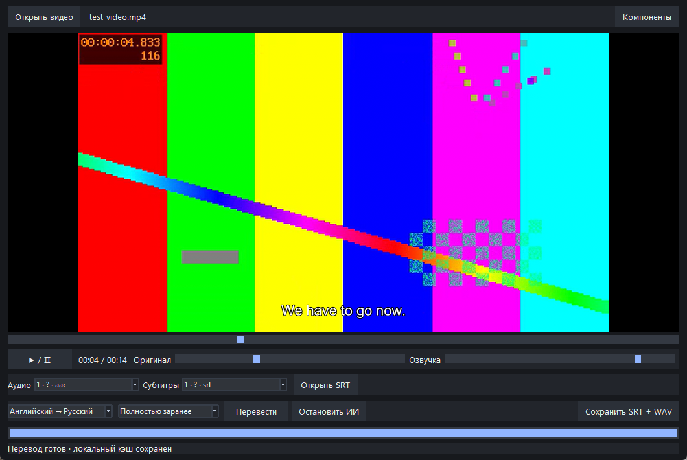

# LocalDub 0.1 — локальный видеоплеер с русской озвучкой

Рабочий Windows x64 MVP. Интерфейс — Python/Tk, воспроизведение — libmpv; ИИ выполняется в отдельном процессе. Никаких web-фреймворков, аккаунтов, облачных API и телеметрии приложения.

[Скачать установщик с моделями](https://github.com/sanderstripa/vlp/releases/download/v0.1.0/LocalDub-0.1.0-Setup.exe) · [Релиз и portable-архив](https://github.com/sanderstripa/vlp/releases/tag/v0.1.0) · [Проверки и замеры](REPORT.md)



## Готовая сборка

Установщик `LocalDub-0.1.0-Setup.exe` устанавливает приложение для текущего пользователя без прав администратора. Модели включены. Удаление сохраняет кэш и затрагивает только файлы приложения.

Распакуйте **весь** архив LocalDub-Windows-x64.zip в доступную для записи папку и запустите `LocalDub.exe` внутри папки LocalDub. Установка Python не нужна. Не переносите EXE отдельно от `_internal`, `native`, `models` и `component-manifest.json`. Модели уже включены; интернет не требуется.

1. «Открыть видео» — выберите MKV/MP4 или другой локальный файл. Обычное воспроизведение работает независимо от ИИ.
2. Выберите аудиодорожку. При необходимости откройте UTF-8 SRT на английском через «Открыть SRT». Одноимённый внешний SRT рядом с видео используется автоматически.
3. «Перевести»: в этой версии поддерживается **английский → русский**, один голос Denis. Переключатель языка честно содержит только эту установленную пару.
4. «Быстрый» начинает воспроизведение при готовности 10 секунд впереди текущей позиции. Если обработка отстала или вы перемотали за готовую область, видео автоматически останавливается и показывает ожидание. «Полностью заранее» держит видео на паузе до завершения всего фильма.
5. Громкости оригинала и озвучки регулируются независимо. Пробел — пауза, полоса под видео — перемотка.
6. После полного перевода «Сохранить SRT + WAV» создаёт два внешних файла с общим именем. Исходное видео не изменяется и не перекодируется.

`test-video.mp4` и `test-video.srt` — короткий синтетический пример с тремя английскими фразами. Для проверки распознавания временно переименуйте SRT перед открытием видео. Встроенные текстовые субтитры выбранной дорожки, либо дорожка с языком en/eng, извлекаются локально в SRT; графические PGS/VobSub не распознаются, вместо них используется ASR. Ответственность за соответствие внешних/выбранных субтитров английской дорожке остаётся у пользователя.

## Сборка из исходников

Нужен 64-битный CPython 3.12 с Tk. Проверено с Python 3.12.14. Из папки исходников:

```powershell
powershell -ExecutionPolicy Bypass -File .\build.ps1
```

Скрипт создаёт локальное окружение `.venv`, устанавливает версии из `requirements-lock.txt`, загружает закреплённые компоненты/модели и собирает `dist\LocalDub\LocalDub.exe`. Нужен интернет на этом шаге. Если команда `python` указывает не на Python 3.12, передайте путь через параметр `-Python` скрипта. Сборка воспроизводима по версиям и ревизиям, но побайтовая идентичность EXE не обещается: PyInstaller и метаданные сборки могут менять байты.

Для установщика дополнительно установите NSIS 3, затем:

```powershell
.\.venv\Scripts\python.exe .\package.py --compiler 'C:/Program Files (x86)/NSIS/makensis.exe'
```

Результат: `release\LocalDub-0.1.0-Setup.exe`. GitHub Actions содержит тот же процесс сборки и реальные CPU pipeline-тесты; WASAPI loopback запускается отдельно на компьютере с аудиоустройством.

Запуск без упаковки после установки зависимостей:

```powershell
.\.venv\Scripts\python.exe -X utf8 .\app.py
```

Повторная явная установка моделей/компонентов:

```powershell
.\.venv\Scripts\python.exe -X utf8 .\setup_components.py
```

`--no-asr` позволяет пропустить ASR при установке для работы только по субтитрам. Кнопка «Компоненты» в плеере запускает загрузку только после явного подтверждения. Автоматического скачивания во время перевода нет.

## Проверки

```powershell
.\.venv\Scripts\python.exe -X utf8 .\test_system.py
.\.venv\Scripts\python.exe -X utf8 .\test_system.py --loopback
.\.venv\Scripts\python.exe -X utf8 .\app.py --smoke .\gui-smoke.json
```

Первый набор реально запускает обе нейросетевые цепочки при запрещённых Python-соединениях, проверяет экспорт, повторный кэш без запуска перевода/TTS/ASR, ошибку повреждённого видео, паузу и перемотку озвучки. Второй тест использует реальный WASAPI loopback: одновременно проигрывает 440 и 880 Гц и проверяет присутствие обоих сигналов в записи. Тест выдаёт слышимые сигналы около трёх секунд. GUI smoke открывает тестовое видео, запускает перевод, проверяет паузу/перемотку и сохраняет JSON; при наличии Pillow также PNG.

Для проверки именно EXE:

```powershell
.\LocalDub.exe --smoke .\exe-smoke.json
```

Команда возвращается до закрытия окна в некоторых оболочках; дождитесь появления JSON. Сравните `audio_backend`, `voice_backend`, `pause_drift_s`, `position_after_seek`, `voice_after_seek`. Для записи вывода CLI worker в оконной сборке используйте `Start-Process -Wait -RedirectStandardOutput`.

## Кэш, ресурсы и синхронизация

Кэш: `%LOCALAPPDATA%\LocalDub\cache`. Идентификатор включает SHA-256 всего видео, SRT, номер аудиодорожки, языки, версию pipeline и манифест компонентов. Первое хеширование большого файла занимает время и выполняется вне интерфейса. Повторно нажмите «Перевести» после открытия фильма — реплики читаются из кэша без повторного инференса. Перемотка внутри готовой области ничего не пересчитывает.

В кэше лежат исходные/переведённые SRT, исходные ASR-реплики по 25-секундным блокам, JSON с таймкодами и отдельные WAV. Запись состояния и готовых WAV атомарная. Незавершённые блоки после остановки могут рассчитываться заново; завершённые реплики сохраняются. Автоматической очистки кэша в MVP нет. При повреждённом кэше приложение сообщает ошибку; можно удалить соответствующую папку кэша.

`metrics.jsonl` сохраняет время стадий и RTF (секунды обработки / секунды обрабатываемой речи или блока), CPU-время процесса, RAM; worker раз в секунду дополнительно снимает RAM и CPU родителя вместе с живыми дочерними процессами. CPU выражен в процентах одного логического ядра: 400% соответствует четырём полностью занятым ядрам. Короткоживущие дочерние процессы могут не попасть в секундные выборки. `first_voice_ready` — готовность первого WAV, а не фактическое начало прослушивания. `playback.jsonl` в папке LocalDub отдельно фиксирует первую передачу озвучки работающему аудиовыходу, ожидания буфера и расхождение часов. Это программные измерения, не акустическая задержка до динамиков.

ИИ использует только CPU, int8 CTranslate2, до четырёх потоков. На Windows выбирается AVX при его наличии, иначе GENERIC; AVX2 не требуется. Все три стадии проверены на Xeon E3-1230 v2. GPU-инференс и CUDA отсутствуют; VRAM ИИ — 0 по устройству исполнения, а не результат измерения всей видеопамяти системы. Видеорендерер libmpv может использовать GPU. GTX 1060 присутствовала в тестовой системе, но производительность CUDA не проверялась и не заявляется. Декодирование видео в этой версии программное ради предсказуемого CPU fallback.

Оригинал и русская речь — два libmpv-контекста, смешиваемые общим WASAPI-выходом Windows. Каждые 50 мс озвучка привязывается к позиции видео, паузе и перемотке; при расхождении более 180 мс выполняется коррекция. Это не точный до сэмпла общий аудиоклок. Реальный микс проверен loopback-записью. Речь ускоряется с сохранением высоты тона максимум вдвое; остаток слишком длинной реплики обрезается с записью `speech_clipped`, чтобы реплики не накапливали задержку. При наложении субтитров приоритет у более поздней реплики.

Переменная `LOCALDUB_DATA` позволяет перенести кэш и журналы в другую папку. Настройка не обязательна. EXE не подписан цифровой подписью.

## Границы MVP

- Только английский → русский, whisper tiny, Marian en→ru int8, один голос Piper Denis medium. Сравнение разных размеров ASR/MT ещё не выполнено; текущий профиль указан в событиях worker.
- ASR режет аудио на независимые 25-секундные блоки без перекрытия. Возможны ошибки на границах, музыке, акцентах и тишине; VAD/OCR/диаризации нет.
- В очереди фильм обрабатывается последовательно от начала. Перемотка далеко вперёд не меняет приоритет очереди; придётся дождаться нужной области либо завершить предварительный перевод.
- Используются короткие независимые реплики без контекста всего фильма. Это машинный закадровый перевод, качество художественного дубляжа не обещается.
- Нет гарантии непрерывной обработки полнометражного 4K на этом CPU: проверен короткий 360p ролик и отдельные сценарии. Реальные фильмы, нагрузку при 1080p/4K и многочасовую устойчивость ещё нужно проверить.
- Нет ARM-сборки, многоголосия, удаления оригинальных голосов, встроенного редактора и автоматического управления размером кэша. Стандартные аудиодорожки/субтитры выбираются; меню DVD/Blu-ray и DRM не поддерживаются.

Подробные результаты и ограничения тестовой среды: `REPORT.md`. Компоненты и лицензии: `THIRD_PARTY.md`.
